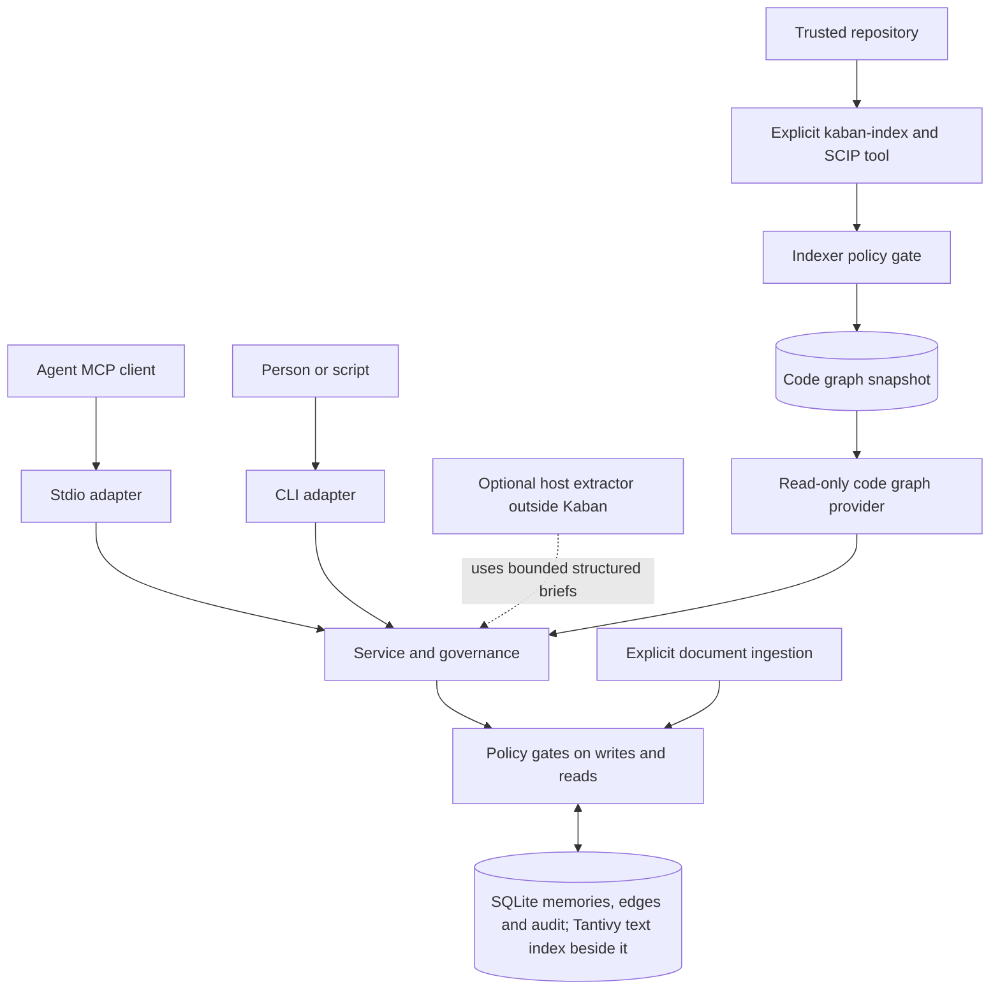

Kaban is a local service library with two entry points: a CLI and a stdio MCP
adapter. Both use the service's content gates and SQLite store. The MCP process
lives with its client; it is not a network daemon.

The diagram is a conceptual separation, not a claim that every read follows the
same physical query. Code snapshots have their own producer/reader path; their
trust and policy handling are not replaced by the memory database's audit chain.

## Canonical records and retrieval

SQLite holds records, typed edges, governance events and an audit chain. The text
index beside it (Tantivy) is derived retrieval state, projected from the records, not
the authoritative human decision. Recall can combine lexical matches, the index's
fuzzy (typo-tolerant) matching and bounded graph expansion; embeddings are
unavailable. There is one storage model (spec 05 OWN-M): opening a store brings the
database to the current schema in one migration (the in-database FTS5 index, its optional
trigram table and the cutover marker of earlier releases are dropped, every body is stored
as an encoded BLOB) and yields a store whose text index exists, admitted as it stands or
rebuilt from SQLite before the open returns. That migration runs only with the database to
one process: an open that finds another kaban process using the old-schema database
refuses with "close the other kaban processes and retry"; concurrent openers of the same
old database wait for the one that migrates. Older binaries refuse the new schema.

Records carry lifecycle and governance information. A proposed Decision does not
become accepted just because a search returns it. Human review, acceptance and
supersession preserve the distinction between a suggestion and an approved rule.
`why` supplies governing context for a path; it is not an `ask` workflow engine.

The policy checks incoming content and outgoing responses; current policy can
hide or mask old records too. The database is not encrypted merely because it is
local or owner-only. Keep its files, keys and backups protected. See
[security](security.mdx) for boundaries and residuals.

## Document input is explicit

Ordinary ingestion extracts Markdown/plain text into documents, sections and
chunks, with bounded processing and a transaction per document. PDF extraction
is an optional feature with no OCR fallback. No file watcher or unattended model
pipeline is implied by `ingest`.

Structured ingestion can produce bounded briefs and slices for a host agent or
an external extractor. `llm` and `gliner` identify instruction dialects, not model
weights loaded by Kaban. Kaban calls no model and executes no external extractor
for these briefs. Candidates and machine claims have their own provenance and
review state; extraction is not acceptance. See [documents](../guides/documents.mdx).

## Code snapshots have a separate producer

`kaban-index` explicitly invokes a SCIP indexer (scip-go, scip-typescript or the
repository's own `kaban-rust-scip`) on a trusted checkout, gates emitted material
and writes a per-commit snapshot that also records what the producer skipped
(its `coverage:*` rows). Indexers may execute repository build code; the selected
isolation tier matters. Default Kaban code tools read an existing snapshot without
invoking that producer. With no usable snapshot they return `no_snapshot` rather
than starting a background build.

Code references on memory records connect project reasoning to source locations.
They are not the code index itself. The [code-graph guide](../guides/code-graph.mdx)
explains snapshot selection, trust and language/toolchain limits.

## Files and processes stay distinct

The database is the CLI/MCP machine interface. Explicit sync/import operations
carry serialized governed records through `.kaban/` files and repository history;
those files are not a second live personal/global database. Optional host hooks
open the same existing store and can flush serialization. Neither hooks nor
`serve` starts code indexing.

M6's two-store/personal-memory design is cancelled. The delivered architecture is
single-store with workspace binding, not merged project/global recall. For
configuration and operational details, continue to
[configuration](../reference/configuration.mdx) and
[maintenance](../operations/maintenance.mdx).
