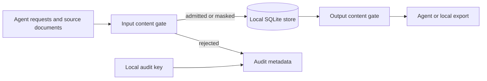

Kaban keeps memory in a local SQLite database and serves MCP over standard input
and output. The server does not expose an HTTP listener; `serve --http` is refused.
Local storage and content scanning reduce exposure, but neither makes arbitrary
input safe or turns the database into an encrypted vault.

## Content policy

Requests cross a content gate before their content is stored or indexed. Built-in
rules recognize credential patterns; a selected YAML policy can add words,
phrases, regular expressions, and narrowly scoped allow rules.

- A **reject** hit refuses the affected request. Credential-class rules reject
  even when the default action is redaction.
- A **redact** hit replaces matching text with the configured mask before storage.
- Document ingestion reports failures per document or chunk. Some rules block a
  whole file; others leave a stub instead of admitting the rejected chunk. Read
  the ingestion report, not just the command's exit status.
- Read-time scanning is enabled by default (`defaults.scan_on_read` in the
  policy); disabling it weakens output protection. Generated exports also pass
  content gates. A stored record is not an unconditional permission to print its
  contents under a later policy.



The diagram describes application boundaries, not an OS sandbox. A process with
permission to read the database or source files can bypass the application.

Policy is selected separately from engine configuration. See
[configuration](../reference/configuration.mdx#policy-file) and
[policy troubleshooting](../operations/troubleshooting.mdx#policy-rejection).

## Audit and keys

The authoritative audit chain lives in the database's `audit` table. It uses
HMAC-SHA256 and a 32-byte key under `KABAN_HOME/keys/<db-id>.key`, created with mode
`0600`. Audit metadata uses rule identifiers and keyed hashes rather than storing
the rejected payload as an audit message.

`--audit-export` (alias `--audit`) optionally writes a JSONL copy. That copy is not
the chain of record and the flag does not itself upload anything. Protect its
directory and any external shipping system separately.

```bash
kaban --db /absolute/path/kaban.db verify-audit
```

Use the same `KABAN_HOME` as the process that created the database. Do not delete
or replace the key to work around a verification failure: a fresh key cannot
verify the existing chain. Keep keys with the protected backup set, not in Git.
The chain is not protection against an attacker who controls both the database
and its signing key.

## Workspaces and host access

Writes are bound to one workspace. Select it with `--workspace` or
`KABAN_WORKSPACE`; otherwise Kaban uses the enclosing Git repository's root
directory name, or `default` outside a repository. Keep the MCP process, CLI, and
hooks on the same database, home, policy, and workspace.

Read operations with a workspace selector can explicitly select another workspace
or `*`. Workspace names are therefore not credentials or a replacement for OS
access control. Use distinct protected databases when clients must not share
access. Repository names can collide; explicitly name workspaces when necessary.

M6's personal/global two-store routing is cancelled. There is no automatic merge
of project and personal memory, and `--global-db` is unavailable.

## Practical limits

- Pattern matching can miss secrets and can flag harmless examples. Never use a
  clean verdict as proof that content contains no sensitive information.
- SQLite data, serialized Markdown, and audit keys are not encrypted by Kaban.
  Use appropriate host permissions, disk encryption, and backup controls.
- Source documents, terminal history, agent transcripts, debug logs, and old Git
  commits are outside the content gate's control. Avoid verbose logging with
  sensitive inputs.
- Explicit indexer/extractor workflows have their own dependencies and trust
  boundaries. A stdio-only server is not a promise that every external tool you
  choose is network-free.
- Purging current records does not erase backups, Git history, remote clones, or
  copies already sent to an agent. See [maintenance](../operations/maintenance.mdx#destructive-operations).
