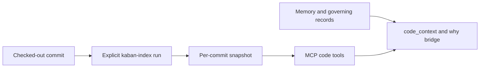

The code graph is a derived snapshot, separate from the memory database. The
`kaban-index` binary runs an external SCIP indexer on one checked-out commit and
writes `<commit40>.cg.db`; `kaban serve` only reads the result through the `code_*`
tools (default build; `--no-default-features` leaves them out). Hooks, sync and
ordinary memory calls never rebuild it in the background.



## What it indexes

Three languages, one per snapshot: `go` (scip-go), `ts` or `typescript`
(scip-typescript) and `rust` (`kaban-rust-scip`, built from `tools/kaban-rust-scip`
in this repository). `kaban-index` detects the language from the root markers
(`go.mod`; `package.json` or `tsconfig.json`; `Cargo.toml`) and `--languages`
(alias `--lang`) picks one when several are present.

Two real repositories on the integrated head, both on this machine
(aarch64 Linux, kernel 7.0.12):

| Repository | Tier | Wall | Files | Symbols | Edges | Snapshot |
| --- | --- | --- | --- | --- | --- | --- |
| Kaban itself (Rust, `0e583ae`) | `none` | 188 s (producer 169 s) | 576 | 75,257 | 425,601 | 209,350,656 B |
| Kaban itself (Rust, `2daaeb1`) | `namespaces` | 231 s (producer 212 s) | 573 | 76,504 | 424,954 | 209,084,416 B |
| GitHub CLI (Go, `v2.102.0`) | `none` | 27 s (producer 15 s) | 911 | 66,907 | 306,065 | 82,886,656 B |
| GitHub CLI (Go, `v2.102.0`) | `namespaces` | 26 s (producer 14 s) | 911 | 66,907 | 306,065 | 82,886,656 B |

Both tiers give the same snapshot for the same tree. A Rust run compiles the
repository's build scripts and proc macros inside the chosen tier (Kaban's 44 build
scripts and 29 proc macros), which is where its minutes go.

## Index a repository

```bash
kaban-index doctor --repo /path/to/repository      # what index would do, and why not
kaban-index trust  --repo /path/to/repository      # once per repository: indexers run build code
kaban-index index  --repo /path/to/repository      # the checked-out HEAD, detected language
kaban-index status --repo /path/to/repository      # every snapshot with its tier and resources
```

`index` requires the trust mark, a clean tracked tree (`git status --porcelain
--untracked-files=no` empty) and a `--commit` (default `HEAD`) that is the checked-out
one. It prints one JSON report on stdout; `wall_ms_per_indexer`, `counts`,
`snapshot_bytes`, `isolation`, `resources` and `skipped_targets_per_indexer` are the
fields to read first. A second run on the same commit answers `already_indexed` and
writes nothing.

Every verb takes `--repo` (default: the working directory) and `--policy <file>`
(before or after the verb; unlike `kaban`, `kaban-index` does not read
`KABAN_POLICY`). The flags of `index` are in the
[kaban-index reference](../reference/kaban-index.mdx).

### Isolation

The tier is chosen at index time, recorded in the snapshot and shown by `doctor`,
`status` and every `code_*` answer. `index.isolation` (`--isolation` per run) is
`preferred` by default: the `namespaces` tier when unprivileged user namespaces work,
else `none` with the warning `isolation_none`. `required` refuses (exit 8) without an
isolating tier; `off` runs `none` without probing. The `container` tier is deferred.

Under `namespaces` the indexer sees the checkout read-only, the admitted toolchain,
the system compiler and its helper directory, one writable scratch directory and no
network. Under `none` it sees your files and network as you do; the environment
allowlist, the scratch quotas, the deadline and the output caps still apply.

### Inputs the runs are given

There is no cache flag. What a run may read beyond the checkout is admitted by its
language and recorded in the snapshot's `resources` meta row (`status` prints it):

- `toolchain`: the admitted toolchain root (Go, Node, the Rust sysroot), read-only.
- `modcache`: the Go module cache (`GOMODCACHE`, else `$HOME/go/pkg/mod`),
  read-only on both tiers. When the installed `go` is older than the `go.mod` `go`
  directive, the matching toolchain already in the module cache is admitted and used.
- `registry`: the Cargo registry (`CARGO_HOME/registry`, else `~/.cargo/registry`),
  read-only on both tiers; Cargo runs offline, so a dependency that is not there fails
  the run instead of downloading.

### Rust specifics

The producer is `kaban-rust-scip` (contract v2, one advertised host:
`aarch64-unknown-linux-gnu`). It must be a release build found on `PATH` or named
with `--indexer rust=/absolute/path`, and the toolchain on `PATH` must be a real Rust
1.99.0 with `rust-src` and the proc-macro server installed (not a rustup proxy: put
the toolchain's `bin` first). `kaban-index` admits
the system C compiler (`/usr/bin/cc`) and pins its backend, binds `/usr/include` into
the view, and honours a `rust-toolchain.toml` whose `channel`, `components`,
`targets` and `profile` (`minimal` or `default`) are already installed. A member
target whose `required-features` are off in the default profile is skipped and named
in `skipped_targets_per_indexer.rust`. Building the producer:

```bash
cd tools/kaban-rust-scip && cargo build --release --locked --offline
install -m 755 target/release/kaban-rust-scip "$HOME/.local/bin/kaban-rust-scip"
```

The installed location must be outside the checkout and outside `KABAN_HOME`.

## What refuses, and why

Indexing is accept by default: a repository is indexed unless something would leave
Kaban's control. What still refuses, each with the line it prints:

| Condition | Class | Line |
| --- | --- | --- |
| No trust mark, or the repository's identity changed since it | `trust_refused`, `trust_revoked` | run `kaban-index trust` again |
| Dirty tracked tree, `--commit` not checked out | `tree_dirty`, `commit_not_checked_out` | commit or stash, then index |
| A `.cargo/config[.toml]` key that redirects the compiler backend (`[target.*] linker`, `rustflags` with `-C linker=`, `-C link-self-contained`, `-B`/`-specs` link arguments, forced `[env]` on `CC`, `PATH`, `COMPILER_PATH` or the target's linker variable, any `LD_*` or `GCC_EXEC_PREFIX` entry) | `rust_cargo_config_redirects_backend` | the producer names the file, the table and the key: `[target.<triple>] linker redirects the compiler backend; remove it to index` |
| `rust-toolchain.toml` with `path`, `profile = "complete"`, or any shape beyond one `[toolchain]` table | `rust_toolchain_selector_unsupported` | the fixed Rust line: the selector is never installed from |
| A `go.mod` `go` directive newer than the installed `go` and than every toolchain in the module cache | `go_toolchain_too_old` | `go toolchain: <installed>, go.mod requires <v>: run 'GOTOOLCHAIN=auto go version' in the repository once (it downloads go <v> into the module cache), or install Go <v>` |
| An indexer or toolchain under the checkout or the data directory, or writable by group or other | `indexer_untrusted_location`, `indexer_untrusted_mode`, `toolchain_refused` | move or `chmod` it |
| `required` isolation on a host without user namespaces | `isolation_unavailable` | exit 8; use `preferred` knowingly |

Everything else that used to refuse now skips, counts and reports: feature-gated
targets, proc-macro crates the build never produced, items inside function bodies,
anonymous items, files shared by several crates, modules with an unresolved import,
bodies whose references differ between `cfg` contexts, tokens without a stable
symbol, and committed sources over the test classifier's bound (classified by their
path only). The counts are the snapshot's coverage, below.

### The content-policy scan is off by default

`index.policy_scan` is `false`: the denylist policy does not scan the code-graph
output, because the snapshot stays on this machine. Every answer then says
`snapshot.policy: "off"`. When it is on, a hit is masked and counted
(`counts:policy_*`), never a refusal, and `policy` reads `current` while the snapshot's
policy version is the live one, else `stale`.

## Read the coverage before trusting an empty answer

The Rust producer counts what it left out and `kaban-index` stores the counters as
`coverage:*` meta rows. Every `code_*` response carries a compact `coverage` object
and, when any gap counter is non-zero, one sentence. On Kaban at `0e583ae`:

```json
"coverage": {
  "declarations": 65449,
  "block_items_unique": 2809,
  "incomplete_modules": 9,
  "skipped_targets": 3,
  "note": "not everything is indexed (targets_skipped 3, proc_macros_not_built 1, block_items_unique 2809, block_item_references 4280, shared_file_contexts_skipped 352, incomplete_modules 9, divergent_bodies 1, tokens_without_symbol 406, derived_impls_generic_skipped 44; the whole table is kaban://code-index); an empty answer does not prove absence"
}
```

"An empty answer does not prove absence" is the reading rule: a function defined
inside another function's body, a crate behind an inactive feature, or a reference
in a module with an unresolved import is not in the graph, so `code_references`
returning nothing means "nothing indexed refers to it", not "nothing refers to it".
The `kaban://code-index` resource holds the whole table, including a `per_crate`
breakdown (declarations and skipped block items per Cargo package). A Go or
TypeScript snapshot has no coverage rows: the object is all zeros with no note. The
[code tools reference](../reference/code-tools.mdx) lists every key.

## Query the snapshot

These are MCP `tools/call` bodies, not CLI subcommands. The target is exactly one of
`symbol`, `ref`, `{label, name}` (optionally with `path`), `{path, line}` or `path`:

```json
{"name":"code_definition","arguments":{"target":{"label":"Struct","name":"Coverage"}}}
```

```json
{"name":"code_context","arguments":{"target":{"path":"crates/kaban-index/src/writer.rs"},"current_path":"crates/kaban-index/src/main.rs"}}
```

Names are exact and case-sensitive. A name that matches several nodes answers
`ambiguous_symbol` with a `candidates` list (label, name, path, line, `ref`): pick a
`ref` and ask again, never guess. A wrong label with a unique name is corrected
(`target_note.label_corrected` names the kind that answered); an unknown name offers
`did_you_mean` across kinds. An external trait (serde's `Deserialize`) answers by
name with `target_note.external: true`; its implementers include derived impls, so
`code_implementers` of `Deserialize` lists 200 or more on Kaban.

What the tools see in a Rust snapshot: inherent members are children of their type
(`code_members` of a struct lists its fields and methods), derived impls are
implementers, a file path is a node whose members are its top-level items, and
document-local symbols (parameters, variables) are hidden from `code_neighbours`
and counted in `locals_hidden` unless `include_locals` is set. `code_context` adds
bounded callers and callees over `REFERENCES` edges (`approximate: true`: no call
graph is derived), linked tests, the governing records of the symbol and the file's
last change. The first call after `serve` starts is answered after a warm-up that
opens and checks the snapshot; the server starts it, you do not.

## Check which snapshot answered

Every answer carries `snapshot`: the `commit`, `exact`, `policy`, `isolation` and
`schema_version`. The reader resolves the working directory's repository identity
(one identity per repository: every worktree of the same `.git` at the same commit
shares the snapshot), prefers `<HEAD>.cg.db` and else the nearest indexed ancestor
within 200 commits, with `exact: false`. An ancestor answer is useful older evidence
about everything you did not change, not a claim about your working tree; re-index
when you need the current commit.

`no_snapshot` means nothing resolved: no key, the wrong working directory, no indexed
ancestor or no repository. Check `kaban-index status`, the server's working directory
and that producer and server share `KABAN_HOME`. `snapshot_too_new` means the reader
is older than the writer: upgrade `kaban` or re-index with a matching version.

## Attach memory to code

`remember` accepts `refs` (`--ref` JSON on the CLI): each CodeRef needs `repo`,
`commit`, `tool` and `relative_path`, with optional symbol/name and nested location
fields. Copy real repository/commit/symbol values from your tools; a flat `line`
field is not the CodeRef wire shape. Positions in CodeRefs are zero-based.

Those anchors connect notes to snapshot symbols and files. `code_context` includes
governing records through the symbol-aware `why` bridge, and MCP `traverse` with
`follow_anchors: true` can return anchored code cards alongside memory nodes. For a
path-only question, use `kaban why --path storage/store.go` even without a snapshot.
[Currency](governance.mdx) says what changed since acceptance, not whether a past
rationale is still the right choice.
