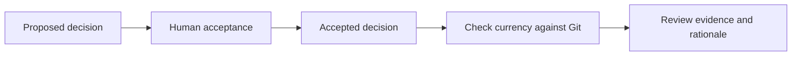

A governing record answers two different questions: what did we choose, and who
accepted that choice? Kaban keeps those separate from whether the surrounding code
has changed since acceptance.

## Propose a decision

From your repository, with the same database/workspace/policy as your server:

```bash
kaban remember Decision 'Keep storage writes transactional.' \
  --summary 'Transactional writes' --path-scope 'src/storage/**' \
  --props '{"rationale":"Partial writes would leave inconsistent records."}'
```

Keep the returned ID. A Decision needs a nonempty rationale; path scopes are
repository-relative paths or globs. Prefer the narrow scope the decision actually
governs, not a project-wide wildcard for convenience. New governed records are
proposed, not silently accepted.



This is the Decision acceptance path, not a general workflow/state-machine feature.

## Accept with the right authority

A person can run the CLI command below, replacing `DECISION_ID` with the returned ID:

```bash
kaban accept DECISION_ID --reason 'Reviewed the tradeoff and approved.' \
  --path-scope 'src/storage/**'
```

CLI acceptance is recorded as `human-cli`. It is not a way for an agent to bypass
confirmation: an agent should use MCP `accept` and follow its response.

```json
{"name":"accept","arguments":{"id":"DECISION_ID","reason":"Reviewed the tradeoff and approved.","path_scope":["src/storage/**"]}}
```

For a shipped Decision, the agent path requires human confirmation. A supporting
host may elicit it directly; otherwise `confirmation_required` returns the prompt
and a one-time token. Show the prompt to the person, obtain agreement, then redeem
the token with `confirmed_by_user: true` through the tool. Tokens expire after ten
minutes and are secrets: never put them in notes, logs or example files.

The loaded ontology sets the acceptance tier. In the shipped ontology, Conventions
and Failures allow agent acceptance; Decisions require a human. Extracting a record
from a document does not itself accept it. Keep signer information and provenance
when evaluating how much to trust a record.

## Ask why before editing

```bash
kaban why --path src/storage/write.rs
kaban why --query 'transactional writes'
```

MCP equivalent for the path:

```json
{"name":"why","arguments":{"targets":[{"path":"src/storage/write.rs"}]}}
```

`why` returns governing records, accepted before proposed ones. Read their rationale
and currency, not just their rank. Currency is evidence about committed change:
`active` means the scope is still current under the check, `needs_review` means at
least half the scope changed, `stale` means all scope entries are gone, and
`uncheckable` means a reliable Git comparison is unavailable (or the record is not
accepted). None of these proves a decision correct or incorrect.

## Work through pending items

```bash
kaban review --status proposed --limit 20
kaban explain DECISION_ID
kaban governance-history --id DECISION_ID
```

`review` lists pending items in the bound workspace; `explain` provides the status,
reason, history and concrete next actions. Other addresses include `e:EDGE_ID`, a
claim key, `x:Kind`, or `path:offset`; copy them from a response rather than guessing.
For replacement, the `SUPERSEDES` relationship points from the new Decision to the
old one. It changes governance, so inspect the records and use the normal authority
rules rather than treating it as an ordinary annotation. Governance history keeps
the replacement chain available.

## Commit history is provenance, not approval

Acceptance can record `accepted_commit`. The optional post-commit hook stamps
`commit_sha` on previously unstamped records; the next sync serializes that stamp.
This behavior remains useful even though remembering a note no longer probes HEAD
for every write. A stamp identifies history, not a correctness certificate.

`kaban doctor` inspects an existing database and reports current diagnostics,
including repository/HEAD availability. A `pending` or `unknown` diagnostic is not
historical proof of where a record was written. Doctor does not create a missing
database. See [operations](../operations/maintenance.mdx) for operational care.
